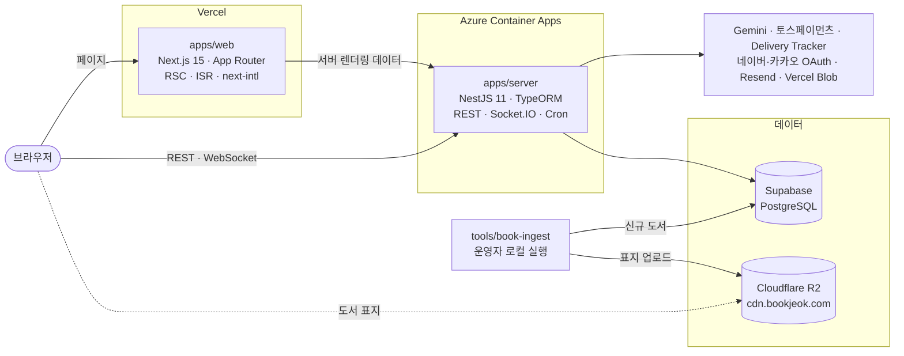

# 북적닷컴 (bookjeok)

**책과 지식의 선순환 플랫폼**

책을 찾고, 읽은 책을 기록하고, 리뷰로 생각을 나누고, 다 읽은 책은 가까운 이웃에게 넘기는 독서 서비스입니다.
도서 검색 · AI 도서 요약 · 독서 기록과 독서 키재기 · 도서 리뷰 · 위치 기반 중고책 거래 · 실시간 채팅을 한곳에서 제공합니다.

[](https://bookjeok.com)
[](LICENSE)
[](https://nodejs.org)
[](https://pnpm.io)
[](https://nextjs.org)
[](https://nestjs.com)
[](https://supabase.com)

---

## 목차

- [한눈에 보기](#한눈에-보기)
- [주요 기능](#주요-기능)
- [시스템 아키텍처](#시스템-아키텍처)
- [기술 스택](#기술-스택)
- [핵심 설계](#핵심-설계)
- [외부 서비스](#외부-서비스)
- [프로젝트 구조](#프로젝트-구조)
- [보안](#보안)
- [테스트와 품질](#테스트와-품질)
- [배포](#배포)
- [로컬에서 실행하기](#로컬에서-실행하기)
- [환경 변수](#환경-변수)
- [문서](#문서)
- [라이선스](#라이선스)

---

## 한눈에 보기

|                |                                                                                          |
| -------------- | ---------------------------------------------------------------------------------------- |
| **서비스**     | https://bookjeok.com                                                                     |
| **구성**       | Turborepo 모노레포 — 웹·서버 앱, 공용 패키지 3개(core / api-client / react-query), 운영자용 도서 적재 도구 |
| **프론트엔드** | Next.js 15 App Router · React 19 · 한국어/영어 · ISR + On-Demand Revalidation            |
| **백엔드**     | NestJS 11 · TypeORM · PostgreSQL                                                         |
| **AI**         | Google Gemini 기반 도서 핵심 요약                                                        |
| **실시간**     | Socket.IO 채팅·알림 게이트웨이                                                           |
| **인프라**     | Vercel(web) · Azure Container Apps(server) · Supabase PostgreSQL · Cloudflare R2(표지)  |

---

## 주요 기능

### 도서 검색

자체 데이터베이스에 쌓은 8만 종 이상의 도서를 제목·저자·출판사·ISBN으로 찾습니다. 검색 중에 외부 도서 API를 호출하지 않습니다.

- `pg_trgm` 부분일치와 PostgreSQL 전문검색을 함께 써서, 서지에 없는 표현도 책 소개에서 후보를 찾습니다
- 관련도와 판매지수로 순서를 정하고, 저자·제목을 섞어 입력해도 원하는 책이 위로 오도록 순위를 보정합니다
- 상단바 통합 검색에서 도서·리뷰·중고 판매글을 한 번에 미리 봅니다(`/` 단축키)
- 검색어를 정규화해 모은 인기 검색어를 보여 줍니다

### AI 도서 요약

도서 상세에서 요약을 요청하면 서버가 DB의 서지와 소개를 Gemini에 넘겨, 소개글과는 다른 분석형 요약을 만듭니다.

- **summary** — 책의 갈등과 핵심 사건을 담은 250~350자 문단
- **keyPoints** — 핵심 인사이트 3가지
- **targetAudience** — 이 책이 필요한 독자의 상황
- **keywords** — 연관 태그 5개

요약은 ISBN 단위로 `ai_book_summaries`에 저장해 같은 책을 다시 생성하지 않고, 모든 AI 요청의 토큰 사용량·지연시간·성공 여부를 `ai_request_logs`에 남깁니다.

### 도서 리뷰

- Tiptap 리치 텍스트 에디터(이미지 리사이즈·하이라이트·정렬·링크·색상)
- 제목 기반 목차와 현재 절 강조, 읽기 진행률
- 별점·태그·공개 범위, 공감/인사이트/응원 리액션, 댓글과 댓글 좋아요
- 본문은 `sanitize-html`로 정제한 뒤 렌더링

### 독서 기록과 독서 키재기

- **독서 기록** — 월별·연도별 독서 캘린더에 완독한 책과 한줄평·감상문을 남기고 개인 독서 통계를 봅니다
- **독서 키재기** — 한 해에 읽은 책을 실제 두께로 쌓아 각설탕부터 기린까지 13가지 사물, 내 키만 한 손그림 캐릭터, 작가 캐리커처(카뮈·사르트르·쿤데라·울프·카프카)와 높이를 견줍니다. 쌓은 장면은 이미지로 공유할 수 있습니다
- **사물 도감** — 기록으로 넘어선 사물이 그 책의 표지색으로 한 해 도감에 모입니다
- **콩** — 다른 사람의 공개 독서 기록에 보내는 작은 리액션. 연필로 그린 콩이 표지 위로 날아가 앉습니다
- **독서 라운지** — 공개 독서 기록을 모두 쌓은 「북적 책동산」, 다른 독자의 최근 기록, 인기 도서, 같은 책을 읽는 독자

### 중고책 거래

카카오 지도와 지오코딩을 이용한 위치 기반 중고책 마켓입니다.

- 시/도·시/군/구 필터, 지도에서 거래 장소 확인, 반경 검색과 거리순 정렬
- 판매글마다 1:1 채팅으로 거래를 조율하고, 예약·거래 완료 상태를 채팅방과 함께 관리
- 거래가 끝나면 구매자와 판매자가 서로 후기를 남기고, 프로필에 「거래 완료 N건 · 긍정 후기 N%」가 표시됩니다
- 판매글 작성과 거래 채팅은 이메일 인증을 마친 회원만 쓸 수 있습니다

현재는 직거래를 지원합니다. 택배 거래용 토스페이먼츠 에스크로 결제도 구현돼 있으며, PG 심사를 마친 뒤 공개할 예정입니다.

<details>
<summary>에스크로 결제 흐름</summary>

```
판매자가 채팅방에서 구매자 선택
        │
        ▼
  AWAITING_PAYMENT ──(24h 미결제)──▶ CANCELLED
        │ 구매자 결제 승인
        ▼
      PAID ──(3일 미배송 자동 환불)──▶ CANCELLED
        │ 판매자 운송장 등록
        ▼
    SHIPPED ──(Delivery Tracker 폴링)──▶ DELIVERED
                                            │
                          구매자 확정 / 2일 후 자동 확정
                                            ▼
                                        CONFIRMED
                                            ▲
              구매확정 거부 → DISPUTED ──────┘ (7일 미해결 시 자동 환불)
```

- **금액 검증** — 결제 승인 금액을 서버에서 판매글 가격과 대조
- **동시성 제어** — `@VersionColumn` 낙관적 잠금과 `x-idempotency-key` 멱등성 처리
- **보상 트랜잭션** — 토스 승인 뒤 DB 저장에 실패하면 자동 환불
- **스케줄러 6종** — 미결제 만료, 미배송 환불, 자동 구매확정, 분쟁 만료 환불, 배송 상태 폴링(30분), 만료 임박 알림(매일 자정)

설계는 [docs/used-book-pay-implementation.md](docs/used-book-pay-implementation.md)에 있습니다.

</details>

### 실시간 채팅과 알림

- **채팅** — 판매글별 1:1 채팅방, 이미지 전송, 타이핑 표시, 참가자별 읽음 워터마크로 계산한 안 읽은 개수
- **알림** — 리뷰 리액션·댓글, 중고거래 진행, 문의 답변, 콩 등을 실시간으로 받습니다. 연결이 끊겼다 다시 붙으면 그사이 알림을 다시 불러옵니다
- **메일** — Resend로 회원가입 인증 링크와 채팅방 개설 알림을 보냅니다

### 그 밖의 기능

- **인사이트** — 지역별 거래 분포, 가격대, 인기 태그, 리액션 비율을 차트로 보여 주는 `/insights`
- **위시리스트** — 관심 도서 모아 두기
- **하단 dock** — 채팅·기록 달력·독서 키재기·최근 본 책·음악을 화면 아래에서 패널로 바로 엽니다
- **배경음악** — 재생목록과 반복 모드를 갖춘 전역 음악 플레이어
- **다국어·다크 모드** — 한국어/영어(`next-intl`), `next-themes`
- **SEO** — `sitemap.ts`, `robots.ts`, RSS(`/rss.xml`), JSON-LD, canonical/hreflang, 페이지별 공유 카드

---

## 시스템 아키텍처



웹과 서버는 공용 패키지를 `@bookjeok/core → @bookjeok/api-client → @bookjeok/react-query → apps/web` 한 방향으로 의존합니다.

서버의 요청 처리 순서는 다음과 같습니다.

```
cookie-parser → helmet → compression → CORS
→ ThrottlerGuard
→ LoggingInterceptor → SmartCacheInterceptor → ActivityTrackingInterceptor
→ CacheInvalidationInterceptor → TransformInterceptor → ClassSerializerInterceptor
→ ValidationPipe(whitelist) → Controller
→ GlobalExceptionFilter(ERROR_CODES)
```

---

## 기술 스택

### 모노레포와 도구

| 항목                | 기술                                                                             |
| ------------------- | -------------------------------------------------------------------------------- |
| 빌드 오케스트레이션 | Turborepo 2 (태스크 그래프 + 캐시)                                               |
| 패키지 매니저       | pnpm 10 Workspaces (`overrides`로 React 19 / axios / TanStack Query 버전 단일화) |
| 언어                | TypeScript 5 (`tsconfig.base.json` 공유)                                         |
| 린트·포맷           | ESLint 9 Flat Config, Prettier 3, `eslint-plugin-simple-import-sort`             |
| 런타임              | Node.js 22.x                                                                     |

### 프론트엔드 — `apps/web`

| 항목            | 기술                                                                                    |
| --------------- | --------------------------------------------------------------------------------------- |
| 프레임워크      | Next.js 15 (App Router, RSC, SSG/ISR, Route Handlers, Server Actions) · React 19        |
| 서버 상태       | TanStack Query v5 + `@lukemorales/query-key-factory`                                    |
| 클라이언트 상태 | Zustand v5                                                                              |
| 스타일링        | Tailwind CSS v4, `tailwind-merge`, `class-variance-authority`, `@tailwindcss/typography` |
| UI 컴포넌트     | Radix UI (shadcn/ui 패턴) + Lucide React                                                |
| 애니메이션      | Framer Motion / `motion`, GSAP, Swiper                                                  |
| 에디터          | Tiptap 3                                                                                |
| 폼과 검증       | React Hook Form + Zod 4                                                                 |
| 차트            | ApexCharts                                                                              |
| 지도·주소       | `react-kakao-maps-sdk`, `react-daum-postcode`                                           |
| 결제            | `@tosspayments/tosspayments-sdk` v2                                                     |
| 실시간          | `socket.io-client`                                                                      |
| 다국어·테마     | `next-intl` 4, `next-themes`                                                            |
| 이미지          | `browser-image-compression`, `@vercel/blob`                                             |
| 계측            | Vercel Analytics / Speed Insights, GA4, Microsoft Clarity                               |
| 테스트·문서     | Vitest 4 + Testing Library + jsdom, Storybook 8                                         |

### 백엔드 — `apps/server`

| 항목       | 기술                                                                  |
| ---------- | --------------------------------------------------------------------- |
| 프레임워크 | NestJS 11 (Express)                                                   |
| ORM / DB   | TypeORM 0.3 · PostgreSQL(`pg_trgm`, `cube`, `earthdistance`)          |
| 트랜잭션   | `nestjs-cls` + `@nestjs-cls/transactional` — 선언적 CLS 트랜잭션      |
| 인증       | Passport (JWT / JWT-Refresh / Naver / Kakao), bcrypt                  |
| 실시간     | `@nestjs/websockets` + Socket.IO 4                                    |
| AI         | `@google/generative-ai` (Gemini)                                      |
| 캐싱       | `@nestjs/cache-manager` 위에 자체 SmartCache 레이어                   |
| 스케줄링   | `@nestjs/schedule`                                                    |
| 이벤트     | `@nestjs/event-emitter`                                               |
| 검증       | `class-validator`, `class-transformer`                                |
| 보안       | `helmet`, `@nestjs/throttler`, `cookie-parser`, CORS 화이트리스트     |
| 메일       | Resend                                                                |
| API 문서   | `@nestjs/swagger` — `/api`                                            |
| 헬스체크   | `@nestjs/terminus` — `GET /health`                                    |
| 테스트     | Jest 29 + ts-jest, Supertest                                          |

### 인프라

| 항목              | 기술                                                            |
| ----------------- | --------------------------------------------------------------- |
| 프론트엔드 호스팅 | Vercel                                                          |
| 백엔드 호스팅     | Azure Container Apps + Azure Container Registry (Docker)        |
| 데이터베이스      | Supabase PostgreSQL                                             |
| 이미지 저장소     | Cloudflare R2(도서 표지), Vercel Blob(사용자 업로드)            |
| CI/CD             | GitHub Actions (`lint` → `test` → `build`, 서버 이미지 배포), GitLab CI |
| 로컬 개발         | Docker Compose (PostgreSQL)                                     |

---

## 핵심 설계

### 1. Contract-First 모노레포

새 기능은 `packages/core`의 인터페이스·`API_PATHS`·쿼리 키부터 정의하고, 서버 DTO가 그 인터페이스를 `implements`합니다. 프론트와 백엔드가 같은 타입을 컴파일 타임에 공유하므로 API 계약이 어긋나면 빌드가 실패합니다. 의존성은 `core → api-client → react-query → web` 한 방향이며, 역방향 import와 앱 간 직접 import를 막습니다.

### 2. 외부 API에 기대지 않는 도서 데이터

검색과 상세는 자체 DB만 읽고, 표지는 자사 CDN(`cdn.bookjeok.com`, Cloudflare R2)에서 나갑니다. 신규 도서는 서버가 아니라 운영자가 로컬에서 돌리는 적재 도구([`tools/book-ingest`](tools/book-ingest/README.md))로 추가합니다. 외부 공급처의 장애·정책 변경·종료가 서비스 응답에 영향을 주지 않습니다.

### 3. SmartCache — 프리픽스 기반 캐시 무효화

`@SmartCache({ prefix, ttl, keyStrategy })`로 응답을 캐싱하고, `@InvalidateCache(prefix)`로 쓰기 시점에 해당 프리픽스의 키를 한 번에 지웁니다. `SmartCacheStore`가 prefix → key 집합을 관리해 cache-manager에 없는 프리픽스 단위 삭제를 제공합니다. `keyStrategy`로 `ip` / `user` / `ip+user` / `global` 범위를 고릅니다.

### 4. 멱등성 인터셉터

`x-idempotency-key` 헤더가 있는 요청은 처리 중 락을 걸어 중복 요청을 409로 막고, 완료된 요청에는 최초 응답을 그대로 돌려줍니다. 재시도가 곧 이중 처리가 되는 결제와 댓글·리뷰·판매글·독서 기록 등록에 씁니다.

### 5. 표준화된 에러 체계

`ERROR_CODES`에 도메인별 코드(`AUTH_xxx`, `SALE_xxx`, `ORDER_xxx` …)를 등록하고 서비스는 `BusinessException`만 던집니다. `GlobalExceptionFilter`가 모든 예외를 같은 JSON 형태로, `TransformInterceptor`가 성공 응답을 같은 봉투로 바꿔 프론트는 하나의 에러 핸들러로 대응합니다.

### 6. 이벤트 기반 회원 탈퇴 정리

탈퇴하면 `user.withdrawn` 이벤트 하나만 발행하고, 채팅·댓글·리뷰·독서 기록·판매글·알림 등 각 도메인 리스너가 자기 데이터를 정리합니다. 도메인 이벤트의 이름과 payload는 이벤트를 소유한 모듈이 정의하고, 발행·구독 헬퍼가 타입으로 계약을 검사합니다. 자세한 내용은 [서버 공용 문서](apps/server/src/shared/README.md)에 있습니다.

### 7. 선언적 트랜잭션 (CLS)

`@nestjs-cls/transactional`로 `QueryRunner`를 메서드마다 넘기지 않고 트랜잭션을 전파합니다. 채팅방과 참가자 생성, 주문 생성과 판매 상태 변경, 리뷰 본문·태그·카운터 갱신처럼 여러 엔티티가 묶인 작업에 씁니다.

### 8. 활동 로그 인터셉터

`@TrackActivity(type)`가 붙은 엔드포인트 호출을 `ActivityTrackingInterceptor`가 `activity_logs`에 비동기로 적재합니다. 로그인·검색·조회·작성 등 30여 곳을 계측합니다.

### 9. PostGIS 대신 cube + earthdistance

전체 GIS 스택이 필요하지 않아 PostgreSQL 기본 확장인 `cube`/`earthdistance`만 쓰고, `ll_to_earth(latitude, longitude)` GiST 인덱스로 반경 필터와 거리순 정렬을 처리합니다.

### 10. 커서 페이지네이션

판매글 목록은 offset 대신 Base64 커서를 써서, 목록이 실시간으로 바뀌어도 중복·누락 없이 무한 스크롤합니다.

### 11. 읽음 워터마크

채팅 읽음 상태를 메시지별 레코드가 아니라 참가자별 `lastReadMessageId` 하나로 저장합니다. 읽음 데이터가 메시지 수에 비례해 늘지 않습니다.

### 12. ISR + On-Demand Revalidation

목록·상세 페이지를 ISR로 정적 서빙하고, 판매글·리뷰 수정처럼 상세 HTML이 바로 틀려지는 쓰기는 서버 액션으로 해당 경로를 즉시 재검증합니다. 목록과 집계는 시간 기반 `revalidate`에 맡깁니다. 규칙은 [apps/web/docs/CACHING.md](apps/web/docs/CACHING.md)에 있습니다.

---

## 외부 서비스

| 서비스                                | 용도                                         | 사용 위치                               |
| ------------------------------------- | -------------------------------------------- | --------------------------------------- |
| **네이버 / 카카오 OAuth**             | 소셜 로그인                                  | `server: auth`                          |
| **네이버 IndexNow**                   | 공개 리뷰 변경 URL 알림                      | `server: review`                        |
| **Google Gemini**                     | AI 도서 요약                                 | `server: llm`                           |
| **토스페이먼츠**                      | 에스크로 결제 승인·취소·웹훅                 | `server: order`, `web: order`           |
| **Delivery Tracker**                  | 택배 배송 상태 조회                          | `server: order`                         |
| **Resend**                            | 인증 링크·채팅 개설·문의 접수 메일           | `server: shared/mail`                   |
| **Vercel Blob**                       | 리뷰·판매글·프로필 이미지 업로드             | `web: /api/upload`, `server`            |
| **Cloudflare R2**                     | 도서 표지 저장·서빙                          | `tools/book-ingest`(업로드), `web`(표시) |
| **카카오 맵 SDK**                     | 거래 위치 지도, 지오코딩                     | `web: shared/components/map`            |
| **다음 우편번호**                     | 배송지 주소 입력                             | `web: order`                            |
| **GA4 · Microsoft Clarity · AdSense** | 트래픽 분석, 행동 분석, 광고                 | `web: shared/components`                |
| **카카오 책 검색 API · 알라딘/YES24 웹** | 신규 도서 후보 탐색과 서지·판형 보강 (운영자 도구 전용) | `tools/book-ingest`            |

---

## 프로젝트 구조

```
bookjeok/
├── apps/
│   ├── web/                  # Next.js 15 사용자 웹
│   │   ├── src/app/          # App Router ([locale] 다국어, route handlers, sitemap/robots/rss)
│   │   ├── src/views/        # 페이지 뷰 조립
│   │   ├── src/features/     # 도메인 기능 (book, search, review, reading-log, book-sale, trade,
│   │   │                     #   chat, notification, order, user, auth, insights, ...)
│   │   ├── src/shared/       # 공용 컴포넌트·훅·유틸·i18n
│   │   ├── src/layouts/      # 헤더, 내비게이션, 하단 dock
│   │   └── docs/             # 컴포넌트 구조·캐시 규칙 문서
│   │
│   ├── server/               # NestJS 11 API 서버
│   │   ├── src/app/          # 루트 모듈 (TypeORM, CLS, Throttler, Cache, Schedule)
│   │   ├── src/features/     # 18개 도메인 모듈
│   │   └── src/shared/       # SmartCache, 에러 체계, 인터셉터, 활동 로그, 메일
│   │
│   └── admin/                # 관리자 포털 (준비 중)
│
├── packages/
│   ├── core/                 # @bookjeok/core — 공유 타입·상수·API 경로·쿼리 키
│   ├── api-client/           # @bookjeok/api-client — Axios 기반 API 호출
│   └── react-query/          # @bookjeok/react-query — 쿼리/뮤테이션 훅과 캐시 무효화
│
├── tools/
│   └── book-ingest/          # 운영자용 신규 도서 적재 도구 (로컬 실행)
│
├── docs/                     # 설계 문서, DB 변경 이력
├── .agents/rules/            # 코드베이스 컨벤션 (개발자·AI 에이전트 공용)
├── .github/workflows/        # CI, 서버 배포
├── docker-compose.yml        # 로컬 PostgreSQL
└── turbo.json
```

---

## 보안

- **소셜 로그인 티켓 교환** — 리다이렉트 URL에 JWT를 싣지 않고 60초 일회용 티켓을 발급해 `POST /auth/exchange`로 교환
- **JWT Silent Refresh** — Axios 인터셉터가 Access Token 만료를 감지해 자동 갱신
- **`tokenVersion` 기반 즉시 무효화** — 로그아웃이나 비정상 세션 감지 시 Refresh Token을 바로 무효화
- **이메일 인증 게이트** — `EmailVerifiedGuard`로 중고거래 기능을 인증 회원으로 제한
- **소켓 인증** — WebSocket 핸드셰이크 단계에서 JWT를 검증하고, 방에 들어갈 때 참여자 여부를 다시 확인
- **Rate Limiting** — 전역 60초당 120회, 로그인·회원가입·티켓 교환은 별도 제한
- **입력 검증** — `ValidationPipe({ whitelist, forbidNonWhitelisted })`로 정의되지 않은 필드 차단
- **XSS 방어** — 리뷰 본문 `sanitize-html` 정제
- **HTTP 보안** — `helmet`, CORS 오리진 화이트리스트, `credentials: true` 쿠키 정책

---

## 테스트와 품질

| 항목          | 내용                                                                                       |
| ------------- | ------------------------------------------------------------------------------------------ |
| 서버 테스트   | Jest — 주문 서비스·스케줄러·토스 연동·채팅 게이트웨이·가드·도메인 이벤트 계약 등           |
| 웹 테스트     | Vitest + Testing Library — 결제 흐름, 거래 후기, 알림, 독서 기록 등                        |
| 컴포넌트 문서 | Storybook 8                                                                                |
| 타입 검사     | `tsc --noEmit`                                                                             |
| 정적 분석     | ESLint 9 + Prettier. 패키지 의존 방향·import 경로·에러 처리 규칙을 린트로 검사             |
| CI            | GitHub Actions에서 `pnpm turbo lint test` → `pnpm turbo build`                             |

```bash
pnpm lint
pnpm test
pnpm build
```

---

## 배포

| 대상            | 방식                                                                                                         |
| --------------- | ------------------------------------------------------------------------------------------------------------ |
| **apps/web**    | Vercel                                                                                                       |
| **apps/server** | GitHub Actions가 서버와 의존 패키지를 검증한 뒤 Docker 이미지를 빌드 → Azure Container Registry → Azure Container Apps |
| **DB**          | Supabase PostgreSQL. 운영은 `synchronize: false`이며 스키마 변경은 [docs/manual-ddl-log.md](docs/manual-ddl-log.md)에 기록하고 수동 적용 |

서버는 단일 인스턴스를 전제로 캐시·멱등성 키·Socket.IO room을 프로세스 메모리에 둡니다. 여러 인스턴스로 늘릴 때 바꿔야 할 지점은 [서버 공용 문서](apps/server/src/shared/README.md#다중-인스턴스-전제)에 정리돼 있습니다.

---

## 로컬에서 실행하기

### 준비

- Node.js 22.x
- pnpm 10.x
- Docker (로컬 PostgreSQL)

```bash
# 1. 의존성 설치
pnpm install

# 2. 환경 변수 (루트에 .env 생성)
cp .env.example .env

# 3. 로컬 DB 실행
pnpm db:up

# 4. 공용 패키지 첫 빌드 (웹은 패키지의 dist를 읽음)
pnpm --filter @bookjeok/core build
pnpm --filter @bookjeok/api-client build
pnpm --filter @bookjeok/react-query build

# 5. 개발 서버
pnpm dev:web      # 웹(http://localhost:3000) + 서버 + 공용 패키지 watch
pnpm dev:server   # 서버(http://localhost:8000) + core watch

# 그 밖에
pnpm storybook    # http://localhost:6006
pnpm db:down      # DB 중지
```

서버를 띄우면 **http://localhost:8000/api** 에서 Swagger 문서를 볼 수 있습니다.

---

## 환경 변수

전체 목록은 [.env.example](.env.example)에 있습니다. 주요 항목:

| 변수                                            | 필수 | 설명                                     |
| ----------------------------------------------- | :--: | ---------------------------------------- |
| `DATABASE_URL`                                  |  ✅  | PostgreSQL 연결 문자열                   |
| `JWT_SECRET` / `JWT_REFRESH_SECRET`             |  ✅  | 액세스/리프레시 토큰 서명 키             |
| `CLIENT_DOMAIN`                                 |  ✅  | CORS와 소셜 로그인 리다이렉트 대상       |
| `NAVER_CLIENT_ID` / `_SECRET` / `_CALLBACK_URL` |  ✅  | 네이버 로그인                            |
| `KAKAO_CLIENT_ID` / `_SECRET` / `_CALLBACK_URL` |  ✅  | 카카오 로그인                            |
| `GEMINI_API_KEY`                                |  ✅  | AI 도서 요약                             |
| `RESEND_API_KEY` / `RESEND_FROM_EMAIL`          |  ✅  | 메일 발송                                |
| `BLOB_READ_WRITE_TOKEN`                         |  ✅  | Vercel Blob 이미지 업로드                |
| `NEXT_PUBLIC_API_URL`                           |  ✅  | 웹이 호출할 서버 주소                    |
| `NEXT_PUBLIC_KAKAO_APP_KEY`                     |  ✅  | 카카오 맵 JS SDK 키                      |
| `FEEDBACK_NOTIFY_EMAIL`                         |      | 문의·제보 접수 알림을 받을 메일          |
| `TOSS_PAYMENTS_SECRET_KEY` / `_CLIENT_KEY`      |      | 토스페이먼츠                             |
| `NEXT_PUBLIC_TOSS_PAYMENTS_CLIENT_KEY`          |      | 결제 위젯 클라이언트 키                  |
| `FEATURE_PAYMENT_ENABLED`                       |      | 결제 기능 플래그 (서버)                  |
| `NEXT_PUBLIC_FEATURE_PAYMENT_ENABLED`           |      | 결제 기능 플래그 (웹)                    |
| `DELIVERY_TRACKER_BASE_URL`                     |      | 배송 추적 API 주소                       |
| `REVALIDATE_TOKEN`                              |      | On-Demand ISR 재검증 시크릿              |
| `USER_WEB_URL`                                  |      | 서버가 재검증·IndexNow에 쓰는 웹 주소    |
| `INDEXNOW_ENABLED`                              |      | 네이버 IndexNow 알림 사용 여부           |
| `NEXT_PUBLIC_GA_MEASUREMENT_ID`                 |      | Google Analytics                         |
| `NEXT_PUBLIC_CLARITY_PROJECT_ID`                |      | Microsoft Clarity                        |
| `NEXT_PUBLIC_GOOGLE_ADSENSE_ID`                 |      | Google AdSense                           |

---

## 문서

### 앱 · 패키지

| 문서                                                                                                                          | 내용                                  |
| ----------------------------------------------------------------------------------------------------------------------------- | ------------------------------------- |
| [apps/web/README.md](apps/web/README.md)                                                                                      | 웹 프론트엔드 개요와 개발 원칙        |
| [apps/web/docs/ARCHITECTURE.md](apps/web/docs/ARCHITECTURE.md)                                                                | 컴포넌트 구성 규칙, i18n 구조         |
| [apps/web/docs/CACHING.md](apps/web/docs/CACHING.md)                                                                          | ISR·쿼리 캐시 구조와 재검증 규칙      |
| [apps/server/README.md](apps/server/README.md)                                                                                | 백엔드 개요, 모듈 구조, 개발 원칙     |
| [apps/server/src/shared/README.md](apps/server/src/shared/README.md)                                                          | SmartCache · 에러 체계 · 멱등성 · 도메인 이벤트 · 메일 |
| [core](packages/core/README.md) · [api-client](packages/api-client/README.md) · [react-query](packages/react-query/README.md) | 공용 패키지 사용법                    |
| [tools/book-ingest/README.md](tools/book-ingest/README.md)                                                                    | 운영자용 도서 적재 도구               |
| [assets/brand/README.md](assets/brand/README.md)                                                                              | 로고 원본과 아이콘·SNS 이미지         |

### 도메인 기능

기능 폴더마다 README가 있습니다.

- **서버** — [auth](apps/server/src/features/auth/README.md) · [user](apps/server/src/features/user/README.md) · [book](apps/server/src/features/book/README.md) · [search](apps/server/src/features/search/README.md) · [search-keyword](apps/server/src/features/search-keyword/README.md) · [llm](apps/server/src/features/llm/README.md) · [review](apps/server/src/features/review/README.md) · [comment](apps/server/src/features/comment/README.md) · [reading-log](apps/server/src/features/reading-log/README.md) · [wishlist](apps/server/src/features/wishlist/README.md) · [used-book-sale](apps/server/src/features/used-book-sale/README.md) · [trade](apps/server/src/features/trade/README.md) · [order](apps/server/src/features/order/README.md) · [chat](apps/server/src/features/chat/README.md) · [notification](apps/server/src/features/notification/README.md) · [feedback](apps/server/src/features/feedback/README.md) · [insights](apps/server/src/features/insights/README.md) · [health](apps/server/src/features/health/README.md)
- **웹** — [auth](apps/web/src/features/auth/README.md) · [user](apps/web/src/features/user/README.md) · [book](apps/web/src/features/book/README.md) · [search](apps/web/src/features/search/README.md) · [review](apps/web/src/features/review/README.md) · [comment](apps/web/src/features/comment/README.md) · [reading-log](apps/web/src/features/reading-log/README.md) · [book-sale](apps/web/src/features/book-sale/README.md) · [trade](apps/web/src/features/trade/README.md) · [order](apps/web/src/features/order/README.md) · [chat](apps/web/src/features/chat/README.md) · [notification](apps/web/src/features/notification/README.md) · [feedback](apps/web/src/features/feedback/README.md) · [insights](apps/web/src/features/insights/README.md)
- **웹 공통 UX** — [intro](apps/web/src/features/intro/README.md) (홈 히어로) · [music](apps/web/src/features/music/README.md) (배경음악) · [confirm](apps/web/src/features/confirm/README.md) (확인 다이얼로그) · [announcement](apps/web/src/features/announcement/README.md) (새 기능 소개) · [cat-cameo](apps/web/src/features/cat-cameo/README.md) (가끔 나타나는 검은 고양이)

### 설계

| 문서                                                                         | 내용                                                |
| ---------------------------------------------------------------------------- | --------------------------------------------------- |
| [docs/used-book-pay-implementation.md](docs/used-book-pay-implementation.md) | 에스크로 결제 설계·상태 머신·엣지 케이스            |
| [docs/book-data-migration-plan.md](docs/book-data-migration-plan.md)         | 도서 표지·서지·검색을 외부 API에서 떼어 낸 과정     |
| [docs/manual-ddl-log.md](docs/manual-ddl-log.md)                             | 운영 DB 스키마 변경 이력 ([docs/ddl/](docs/ddl/))   |
| [.agents/rules/](.agents/rules/)                                             | 코드베이스 컨벤션 — [모노레포](.agents/rules/01-monorepo-packages.md) · [서버](.agents/rules/02-server-conventions.md) · [프론트엔드](.agents/rules/03-frontend-conventions.md) · [체크리스트](.agents/rules/04-checklist.md) |

검색 품질·SEO·비용 점검 같은 조사 기록은 [docs/](docs/)에 있습니다.

---

## 라이선스

[MIT License](LICENSE)
