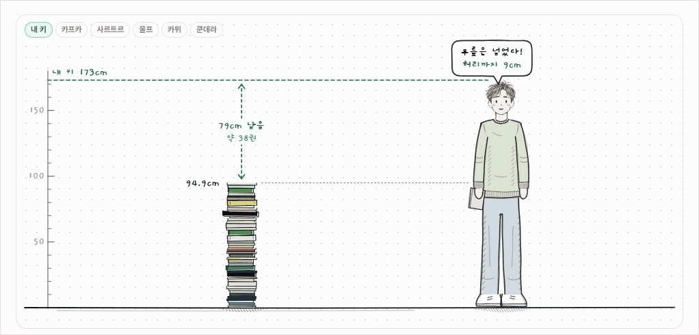
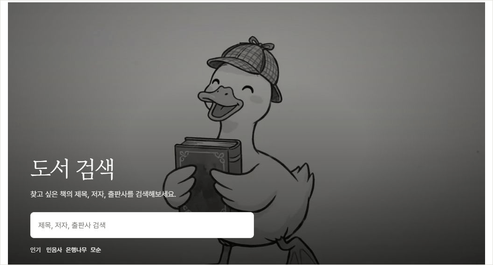
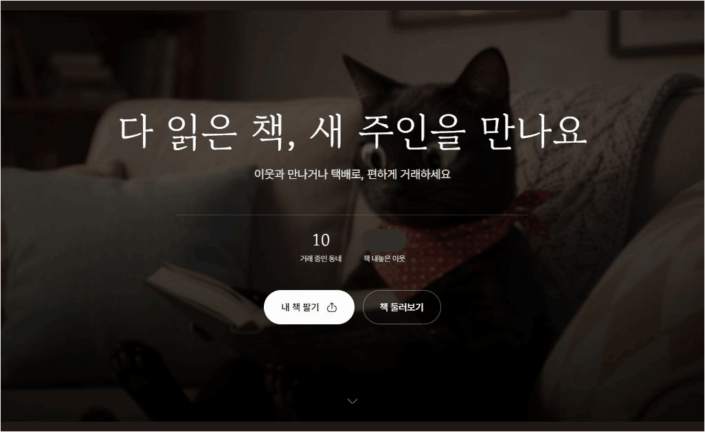

  

<h1 align="center">북적닷컴</h1>

  <strong>읽은 책이 내 키만큼 쌓일 때까지.</strong>

  다음에 읽을 책을 찾고, 다 읽은 날엔 달력에 한 줄을 남깁니다. 
  기록이 쌓이면 책 더미의 높이를 재고, 책장에 남은 책은 동네 독자에게 건넬 수 있습니다.

  <a href="https://bookjeok.com"><strong>북적닷컴 바로가기 ↗</strong></a>
  ·
  <a href="#서비스-화면">서비스 화면</a>
  ·
  <a href="#다른-독자와-함께">라운지·책리뷰·중고마켓</a>

## 서비스 화면

### 올해 읽은 책으로 키를 재요

독서 달력에 완독 날짜와 한 줄 평을 남기면, 그해 읽은 책이 한 권씩 쌓입니다. 책마다 두께를 반영한 책 더미를 내 키나 작가의 키와 비교하고, 그 장면을 이미지로 저장해 공유할 수 있습니다.

_북적닷컴의 공개 예시 46권으로 촬영했습니다._

[독서 키재기 체험하기 ↗](https://bookjeok.com/ko/reading-height) · [독서 기록 둘러보기 ↗](https://bookjeok.com/ko/reading-log)

### 같은 제목이라도 판본은 다르니까

제목, 저자, 출판사, ISBN으로 책을 찾을 수 있습니다. 『월든』처럼 판본이 여럿인 책은 표지와 출판사를 확인해 고르고, 관심 있는 책은 위시리스트에 담아둡니다. 도서 상세에서 책 소개와 독자 리뷰를 보고, 로그인하면 AI 요약도 읽을 수 있습니다.

[도서 검색 열기 ↗](https://bookjeok.com/ko/book/search)

## 다른 독자와 함께

### 독서 라운지

내가 한 권을 기록하면, 독자들이 함께 쌓는 **북적 책동산**에도 한 권이 올라갑니다. 책동산에 막 올라온 책을 눌러 한 줄 감상을 읽고, 마음에 닿는 기록에 ‘콩’을 남길 수 있습니다.

[독서 라운지 둘러보기 ↗](https://bookjeok.com/ko/lounge)

### 책리뷰

무슨 책을 읽을지 고민될 때는 장르나 태그로 리뷰를 찾아보세요. 별점만으로 알기 어려운 이야기는 본문에서 읽고, 같은 책을 읽은 뒤에는 사진을 곁들여 내 감상을 남기거나 댓글로 이야기를 이어갈 수 있습니다.

[책리뷰 읽기 ↗](https://bookjeok.com/ko/book/reviews)

### 중고마켓

읽고 싶은 책을 검색하거나 지역과 가격대로 판매글을 좁혀 볼 수 있습니다. 실물 사진으로 책 상태를 살핀 뒤 채팅으로 거래를 조율하고, 거래가 끝나면 서로 후기를 남깁니다.

[중고마켓 둘러보기 ↗](https://bookjeok.com/ko/book/market)

_운영 사이트에서 촬영했습니다. 닉네임, 프로필 사진, 상세 거래 장소는 가렸습니다._

## 라이선스

이 저장소의 소스 코드는 [MIT License](./LICENSE)를 따릅니다.
